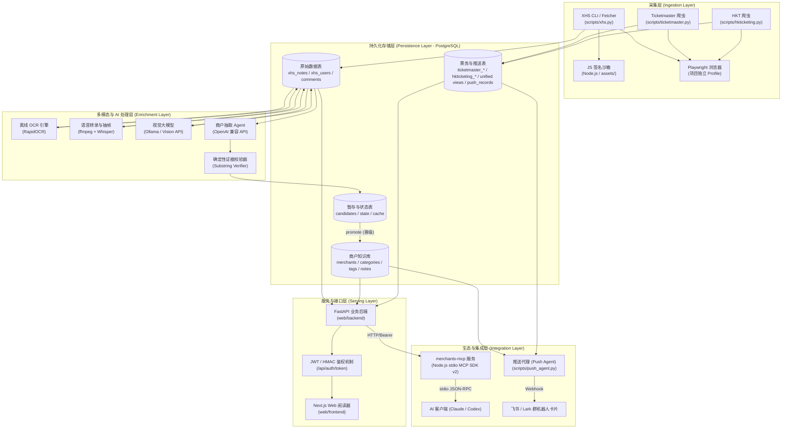
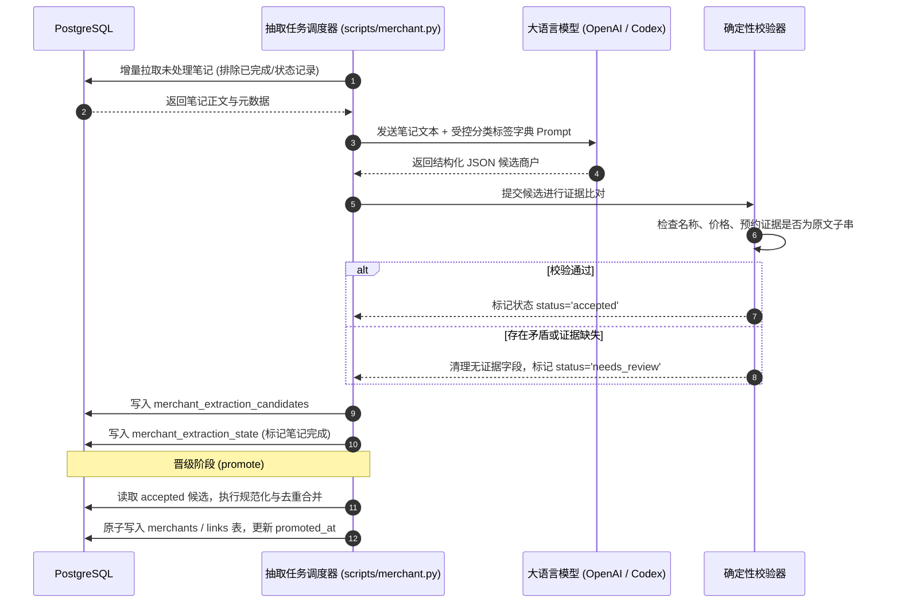
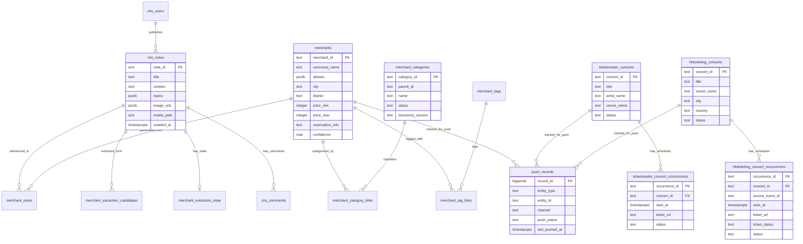

# 系统架构设计 (ARCHITECTURE.md)

## 1. 架构愿景与核心原则

本项目采用**松耦合、多层管道式、以统一关系存储为核心**的系统架构。设计遵循以下核心原则：

- **单一数据源 (Single Source of Truth)**：PostgreSQL 作为全系统唯一可信持久化数据库，爬虫引擎、智能抽取器、Web 接口、MCP 插件和推送服务直接共享该数据库，消除异构存储同步延迟与一致性隐患。
- **阶段性流水线与解耦 (Staged Pipeline)**：采集、多模态处理、实体抽取、索引晋级与业务展现各环节保持独立生命周期，任意阶段故障不影响其他阶段数据。
- **确定性校验门禁 (Deterministic Gatekeeper)**：大模型仅充当“理解与提取”的感知层，结构化数据落库前必须经受确定性代码逻辑的严密证据校验。
- **全流程幂等游标 (Fine-Grained Resumability)**：所有耗时任务具备行级或页级游标，进程崩溃重启后自动平滑断点续跑。

---

## 2. 系统整体分层架构



---

## 3. 核心子系统设计

### 3.1 采集子系统 (Ingestion Subsystem)
- **小红书采集**：由 `scripts/xhs_fetcher.py` 驱动。请求发送前通过本地子进程调用 `assets/xhs_a1.js` 和 `assets/xhs_xray.js`，根据请求路径与载荷动态计算 `x-s`、`x-t` 等防篡改签名。
- **DOM 搜索模式**：Playwright 以独立上下文加载 `data/pw_profile_*`，模拟真实人类浏览，规避风控，抓取后将笔记元数据与搜索缓存写入数据库。
- **Ticketmaster 采集**：针对新加坡站通过定制请求头与新加坡语言/时区设置，由 Playwright 自动化完成 Cloudflare/EPS 反爬挑战，直接解析详情页内嵌的 `calendarEvents` 结构化 JSON。
- **HKT 采集**：`scripts/hkticketing.py` 使用独立 Playwright Profile 完成 Baxia 校验，通过公开 JSON 接口解析“演唱會”分类、项目详情、场次和票档；数据写入 `hkticketing_*` 分表。
- **统一读取层**：`concerts_unified` 与 `concert_occurrences_unified` 通过 `UNION ALL` 汇总各平台数据，API、MCP 和推送只读取统一视图，平台适配器分别写入来源表。

### 3.2 多模态与 AI 解析子系统 (Enrichment Subsystem)
- **分层解析策略**：针对图片采用“纯文字 OCR → 多模态视觉总结 → Mermaid 路线图转化”三级进阶；针对视频采用“ffmpeg 抽帧+音轨抽取 → Whisper 离线转录 → 关键帧 OCR 汇总”。
- **缓存与失效模型**：所有多模态计算均以媒体内容哈希为键持久化至数据库。正文或多模态配置未变动时直接复用缓存，失败任务记录于独立重试队列。

### 3.3 商户情报抽取与晋级子系统 (Merchant Intelligence Subsystem)
- **受控分类字典 (Taxonomy)**：后端预置严密的分类与标签体系（版本化管理，如 `v1`），抽取 Prompt 强制 Agent 仅能在指定字典中选择 `category_ids` 与 `tag_ids`。
- **候选落库与证据校验**：大模型结构化输出先入库至 `merchant_extraction_candidates`。校验引擎执行严格的 Python 子串比对与逻辑验证：
  1. 商户名称必须能在笔记正文/标题中找到；
  2. 价格、人均基准必须匹配正文数值描述；
  3. 预约信息必须有对应文字证据；
  4. 校验不通过或缺少证据的字段强制清空，整条记录进入 `needs_review` 队列。
- **幂等晋级 (Promote) 与去重 (Dedupe)**：晋级任务扫描 `status='accepted'` 候选，应用 Unicode 规范化算法对同名/别名商户合并，原子写入主表 `merchants` 及多对多关系表。

### 3.4 交付与生态接入子系统 (Serving & Integration)
- **API 鉴权与安全边界**：
  - 后端统一配置 `API_AUTH_KEY`（静态高强度密钥），客户端通过 `/api/auth/token` 换取短期 Bearer JWT（默认 TTL 为 7200 秒）。
  - 所有数据读写接口强制校验 Bearer Token。
- **Model Context Protocol (MCP)**：
  - `merchants-mcp` 充当 AI Agent 与后端的透明安全桥梁。
  - 通过 stdio 提供标准协议接口，内置 Token 自动续期与并发安全请求池，返回结果进行文本长度截断保护（12000 字符限制），防范 Prompt 爆炸。
- **增量推送代理 (Push Agent)**：
  - 采用多态推送追踪表 `push_records (entity_type, entity_id, channel)`，每次只抽取未推送增量，由大模型总结成简明生活指南后推送飞书富文本卡片。

---

## 4. 关键业务时序流

### 4.1 商户知识抽取与校验晋级流



### 4.2 AI Agent 通过 MCP 查询商户流程

```mermaid
sequenceDiagram
    autonumber
    participant User as 终端用户
    participant Agent as AI 助手 (Claude / Codex)
    participant MCP as merchants-mcp (stdio)
    participant API as FastAPI 后端
    participant DB as PostgreSQL

    User->>Agent: "帮我推荐香港尖沙咀适合约会的海景餐厅"
    Agent->>MCP: list_merchant_categories(keyword="餐厅")
    MCP->>API: GET /api/merchant-categories (Bearer Token)
    API->>DB: 递归 CTE 查询分类树与商户统计
    DB-->>API-->>MCP-->>Agent: 返回 category_id="restaurant" 等
    Agent->>MCP: list_merchant_tags(category_id="restaurant")
    MCP->>API-->>Agent: 返回 "适合约会", "海景" 对应 tag_id
    Agent->>MCP: search_merchants(category_id, tag_ids, district="尖沙咀")
    MCP->>API-->>Agent: 返回符合条件的商户列表及摘要证据
    Agent->>MCP: get_merchant_details(merchant_id="xxx")
    MCP->>API-->>Agent: 返回商户详情、价格证据、关联真实笔记正文及链接
    Agent-->>User: 综合真实笔记评价生成回答，并附笔记标题与来源链接
```

---

## 5. 实体关系图 (Entity-Relationship Diagram)


